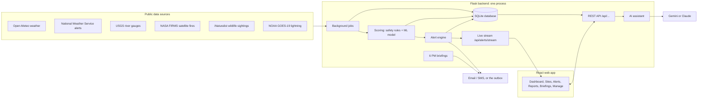
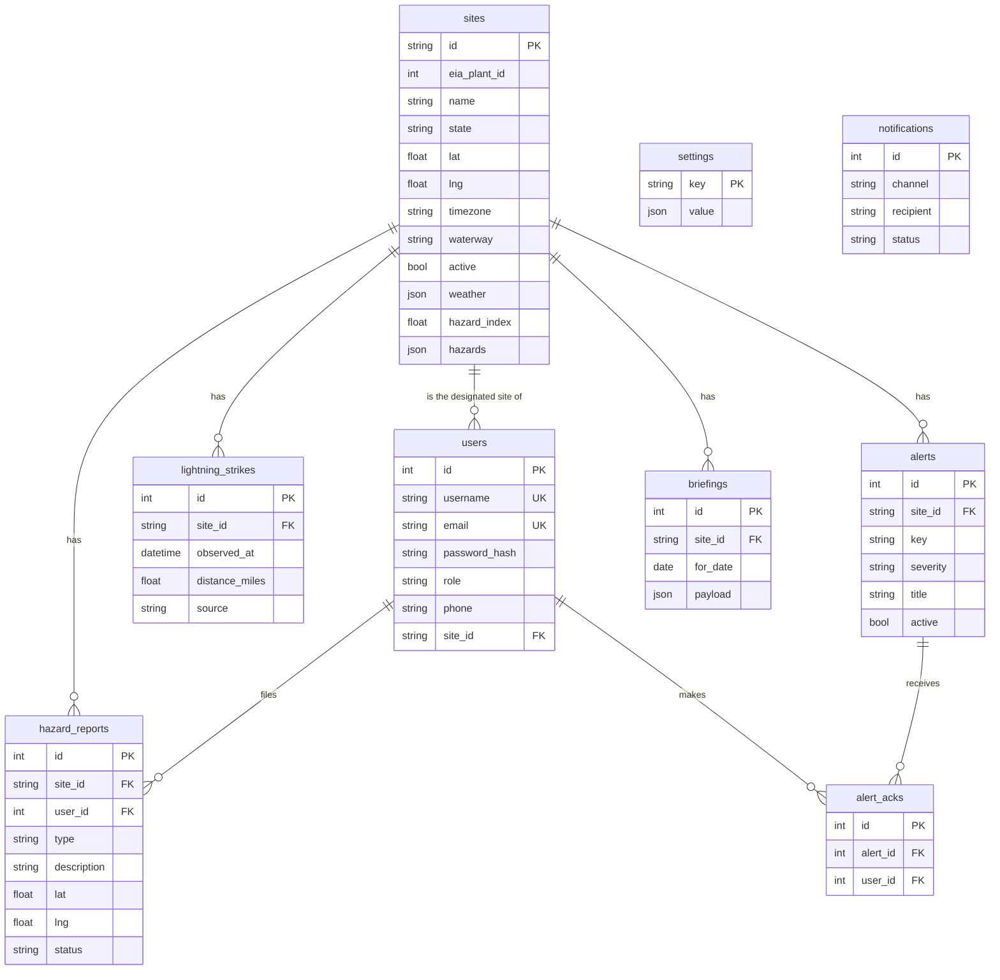

# PlanIT Control: how it works

This document explains how the pieces of PlanIT Control fit together: the backend, the data feeds, the hazard index, the ML model, the AI assistant, the frontend and the database. For every endpoint see [API.md](API.md); for running and hosting see the [README](../README.md) and [DEPLOY.md](DEPLOY.md).

## 1. The big picture

PlanIT Control is two programs:

- **Backend** (`backend/`, Python + Flask): one process that pulls live environmental data for 58 real power-plant sites, scores every site, raises alerts, sends 6 PM briefings, answers the AI assistant and serves the REST API. It also serves the built website, so in production everything runs on one port.
- **Frontend** (`frontend/`, React): the web app crews and supervisors use. It only talks to the backend's REST API (`/api/...`) and its live-update stream.



The cycle in one sentence: **background jobs fetch data → save it on each site → rescore the site (rules + ML) → create or clear alerts → push them to open browsers (and email/SMS for stop-work) → the website reads everything through the API.**

## 2. Backend

### Stack

| Piece | Used for |
|---|---|
| Flask 3 | web framework and REST API (one blueprint per resource in `app/api/`) |
| Flask-SQLAlchemy / SQLAlchemy 2 | database models and queries (`app/models.py`) |
| SQLite (WAL mode) | the database file `backend/instance/planit.db` |
| Flask-Login | sign-in sessions (an HttpOnly cookie) |
| APScheduler | background data jobs, inside the web process |
| requests, numpy, pyfive | calling data sources; reading NOAA's lightning files |
| Anthropic SDK / Gemini REST API | the AI assistant |
| Waitress (`serve.py`) or Flask's dev server (`run.py`) | serving it |

### Startup

`run.py` (development) and `serve.py` (production) do the same thing:

1. **Port check** (`app/ports.py`): if port 5000 is already taken, exit with "already running" instead of starting a second copy.
2. **`create_app()`** (`app/__init__.py`): load settings from `backend/.env` (`config.py`), set up the database, sign-in, error handlers and all API blueprints.
3. **`init_db()`** (`app/seed.py`): create missing tables, apply small in-place upgrades (for example adding `users.site_id` to older databases), load the 58 sites from `data/sites.csv` on the first run, store default settings, and in development create the demo accounts `supervisor` and `crew`.
4. **Start the background jobs** (`app/jobs.py`), staggered over the first two minutes.
5. **Serve** on port 5000: the API under `/api/...` and the built website for every other path (`app/api/spa.py`).

### Background data jobs

| Job | Source | Every | Saved on the site as |
|---|---|---|---|
| Weather | Open-Meteo forecast API: one request for all 58 sites (current, hourly, 3 past + 8 forecast days) | 60 min | `weather` |
| Weather warnings | National Weather Service `alerts/active?point=…` per site | 10 min | `nws` |
| Rivers | USGS stream gauge nearest the site (prefers one on the site's own waterway), 24 h level change | 30 min | `river` |
| Wildfires | NASA FIRMS VIIRS satellite detections (last 24 h, two satellites) | 60 min | `fire` |
| Wildlife | iNaturalist sightings of alligators, venomous snakes, black bears and cougars within 10 mi, last 30 days | 12 h | `wildlife` |
| Lightning | NOAA GOES-19 Geostationary Lightning Mapper files (a new one every 20 s) from NOAA's public cloud bucket | 60 s | rows in `lightning_strikes` (flashes within 30 mi, kept 3 h) |
| Briefings | checks each site's local time; at 6 PM builds tomorrow's briefing | 5 min | rows in `briefings` |

Every job follows the same path (`app/services/ingest.py`): **fetch** outside any lock (network calls can be slow) → **save** under one write lock (SQLite allows one writer at a time) → **rescore** the affected sites → **sync alerts** → **announce** new alerts.

### Alerts

`app/services/alert_engine.py` turns a site's scores into alerts. There is at most one active alert per site and rule; each refresh creates alerts for newly broken rules, updates continuing ones and clears the rest. Thresholds are supervisor-editable (Manage › Alert rules); the defaults:

| Rule | Fires when | Severity |
|---|---|---|
| Lightning | a strike within **10 mi** in the last **30 min**; the all-clear countdown restarts with every new strike | stop-work |
| Flood risk | a site on a river or bay with **2"+ of rain in 24 h**, or its gauge up **2 ft+** | warning |
| Extreme heat | heat index **105°F+** in the next 12 h | warning |
| High wind | gusts **35 mph+** in the next 12 h (crane and lift limits) | warning |
| Wildfire | a satellite fire detection within **10 mi** | warning |
| NWS warning | any official NWS *Warning* at the site (Tornado and Extreme Wind Warnings are stop-work) | warning / stop-work |
| High index | hazard index **7.5+** and no other alert already covers its top hazard | info |

New alerts are **published on an in-process event bus** (`app/services/events.py`). Every open browser holds a Server-Sent Events connection to `/api/alerts/stream`, so alerts appear within a second; pages also poll every 15 to 60 s as a fallback. **Stop-work alerts** additionally go out by email and SMS (`app/services/notify.py`). Without SMTP/Twilio settings nothing is sent and each message is saved in the `notifications` table instead (the outbox in Manage › Briefings).

### Next-day briefings

Every 5 minutes, `briefings.run_due()` looks for sites whose local time has passed the send time (18:00 by default, in each site's own time zone) and that have no briefing for tomorrow yet. For each it builds a briefing from the first day of the site's forecast: tomorrow's hazard index, go/no-go call, a summary and the top two hazards with recommended controls. It stores it in `briefings` and delivers one digest per recipient on the enabled channels (email, SMS, browser push).

### Security

- **Two roles:** crew and supervisor. Supervisors hold every management privilege (there is no separate admin); checks happen on the server (`supervisor_required`).
- **Passwords** are stored hashed (Werkzeug). Changing your own username, email or password needs your current password.
- **Session cookie** is HttpOnly, SameSite=Lax, and HTTPS-only in production.
- **Rate limits:** 10 sign-ins/min and 5 sign-ups/min per address; 20 chat messages/min per user.
- **Uploaded photos** are accepted only if their bytes are a real JPEG, PNG, GIF or WebP (≤10 MB), stored under random names, and served only to signed-in users.
- **Hazard reports** can be edited or deleted by the person who filed them or by a supervisor; only supervisors change a report's status.

## 3. The hazard index (0-10)

Computed in `app/services/hazards.py` every time a site's data changes. It has four steps.

### Step 1: seven hazard scores, each 0-10

Each hazard maps a live reading onto 0-10 with breakpoints; values in between are interpolated.

| Hazard | Live input | Breakpoints (reading → score) |
|---|---|---|
| Extreme heat | highest heat index (feels-like temperature) in the next 12 h | 80°F → 0, 90 → 3, 103 → 6, 115 → 9, 125 → 10 (NWS categories) |
| Lightning | GOES strikes; storm energy (CAPE); thunderstorm forecast | strike within 10 mi in the last 30 min → **10**; flashes within 30 mi in the last hour → 7; otherwise CAPE 1,000 J/kg → 2, 2,500 → 4, 4,000 → 5.5, or 5 if thunderstorms are forecast today |
| Flooding | rain in the last 24 h; river gauge rise for sites on a waterway | rain 0.5" → 2, 1" → 3.5, 2" → 6, 4" → 9, 6" → 10 (capped at 8 away from water); rise 1 ft → 2, 3 → 6, 6 → 9, 10 → 10 |
| Wildfire | nearest satellite fire detection; dry and windy weather | ≤5 mi → 9, ≤10 → 7, ≤25 → 4; humidity under 20% with gusts 25 mph+ adds 2 |
| Soil saturation | soil moisture 3-9 cm deep | 0.15 m³/m³ → 0, 0.25 → 3, 0.35 → 6, 0.42 → 8, 0.48 → 10 |
| Wildlife | dangerous-species sightings within 10 mi (30 days); crew wildlife reports (7 days) | 1 sighting → 3, 3 → 5, 10 → 6.5; any crew report → 7 |
| Wind / storms | strongest gust in the next 12 h | 15 mph → 0, 25 → 3, 35 → 6, 45 → 8, 55 → 10 |

Official **NWS alerts set minimum scores**, for example Tornado Warning → wind 10, Flash Flood Warning → flooding 8.5, Severe Thunderstorm Warning → lightning 8, Excessive Heat Warning → heat 8, Heat Advisory → heat 6, Red Flag Warning → wildfire 7.

### Step 2: combine them

```
rules index = 0.6 × worst hazard + 0.25 × second worst + 0.15 × average of all seven
```

One extreme hazard dominates, the second adds to it, and the rest nudge it.

### Step 3: safety floors

- An active **lightning stop-work** keeps the index at **8 or more**.
- An active **NWS warning** keeps it at that warning's minimum or more.

### Step 4: the ML model can raise it

```
model index = 10 × (the model's probability of a reported hazardous event near the site today)
hazard index = max(rules index, model index)
```

The model can raise the index but never lower what a safety rule requires.

**Bands:** 0-2.5 Low (GO), 2.5-5 Moderate (GO), 5-7.5 High (CAUTION), above 7.5 Extreme (NO-GO).

**Also produced:** plain-language **drivers** (the top reasons, for example "Heat index up to 101°F in the next 12 h"), a **conditions** table of current readings, and a **7-day forecast** that applies the same breakpoints (and the ML model) to each forecast day. Tomorrow's forecast entry becomes the 6 PM briefing.

**Example:** heat index 103°F (heat 6), gusts 25 mph (wind 3), some storm energy (lightning 2), everything else 0 → 0.6 × 6 + 0.25 × 3 + 0.15 × 11/7 = **4.6, Moderate, GO**. If NWS issues an Excessive Heat Warning, heat becomes 8 and the floor lifts the index to **8.0, NO-GO**.

## 4. The ML model

### What it predicts

The probability that NOAA's Storm Events database records a **thunderstorm wind, lightning, hail, tornado, flood, heavy rain, heat, high wind, tropical storm or wildfire event within 25 miles of the site, or in its NWS forecast zone or county, on a given day**: the hazards field crews actually stop work for.

### How it was built (`backend/ml/fit_hazard_model.py`)

1. **Outcomes (labels):** NOAA Storm Events reports for 2023-2025. Reports with coordinates are matched to sites within 25 miles; reports filed for a whole area are matched through each site's NWS forecast zone and county (looked up from `api.weather.gov`). Multi-day events count for each day, up to 10.
2. **Inputs (features):** daily historical weather at each site from the Open-Meteo archive, using the same daily values the live forecast provides. 13 features:

   | Feature | Meaning |
   |---|---|
   | `heat_index_max_f`, `heat_above_90_f` | the day's highest heat index, and degrees above 90°F |
   | `rain_log`, `rain_hours` | log(1 + rain in inches), hours of rain |
   | `rain_prev_3d_log` | log(1 + rain over the 3 days before): wet ground, rising water |
   | `gust_max_mph`, `gust_above_30_mph`, `wind_max_mph` | strongest gust, gust beyond crane limits, strongest sustained wind |
   | `humidity_min_pct` | lowest relative humidity |
   | `season_sin`, `season_cos` | time of year |
   | `lat`, `lng` | region |

3. **Model:** logistic regression with L2 regularisation, fitted with Newton's method in numpy on standardised inputs. It's small, fast and explainable: each feature's push on the risk can be read off, which is how the app names the "main factor".
4. **Check:** fitted on 2023-2024, tested on 2025 (a year it never saw). 63,568 site-days, 4.3% hazardous.

   | On 2025 | ML model | Rules on the same weather |
   |---|---|---|
   | Ranks hazardous days above calm ones (ROC AUC) | **0.854** | 0.757 |
   | Probability error (Brier score, lower is better) | **0.032** | 0.036 if always guessing the average |

5. **Refit on all three years** and saved as `backend/ml/hazard_model.json` (feature list, means, scales, coefficients, intercept, the checks above).

### How the app uses it (`app/services/hazard_model.py`)

On every rescore it builds the same 13 features from the site's live daily forecast (today, plus the 3 previous days for recent rain), computes the probability, and turns it into `10 × probability` for the index, the site's **"ML model risk today"** reading (`conditions.modelRiskPct`), and a driver line such as "Hazard model: 64% chance of a reported storm, flood, heat or wind event nearby, mainly extreme heat" when it matters. It scores each forecast day the same way. If the model file is missing, scoring falls back to the rules alone (`scoring.method` is `rule-based` instead of `ml+rules`).

**Refit:** `cd backend` then `.venv\Scripts\python -m ml.fit_hazard_model` (about 10 minutes the first time; downloads are cached in `ml/data/`).

**Limits:** the labels are storm reports, not worker injuries (OSHA Severe Injury Reports would tie it more closely to workplace outcomes), and lightning energy (CAPE) isn't available in the historical archive. Because hazardous days are rare, its probabilities are usually low, so the safety rules decide most indexes and the model mostly raises unusually risky days.

## 5. The AI assistant

```
Ask PlanIT AI (browser) ──POST /api/chat { messages, siteId }──▶ backend
   backend: validate → build site data → system prompt + data → Gemini or Claude → reply text
```

1. **Frontend** (`components/chat/ChatWidget.jsx`): the floating button on every page. It sends the conversation (up to 20 messages) and the site on screen, if any.
2. **Backend** (`app/api/chat.py`, `app/services/assistant.py`):
   - checks the user is signed in and under 20 messages a minute, and validates the messages;
   - builds the **site data** the model may use:
     - `allSites`: every site in brief (hazard index, go/no-go, top reasons), riskiest first;
     - `siteDetails`: full live readings, hazard scores, active alerts, lightning countdown and tomorrow's briefing for **the site on screen, the user's own site, and any site named in the conversation** (matched loosely, so "baldwin" or "w.a. parish" work and follow-up questions keep the site);
   - adds fixed rules: answer only from the data, never call it safe during a stop-work, send injuries to 911 first, reply in short plain text for phones.
3. **Model:** **Gemini** (`gemini-3.8-flash`, REST `generateContent`) when `GEMINI_API_KEY` is set, or **Claude** (`claude-opus-5-5`, Anthropic SDK) when `ANTHROPIC_API_KEY` is set (Claude wins if both are set, unless `ASSISTANT_PROVIDER=gemini`). The key stays on the server. Refusals and blocked prompts get a polite answer; errors are logged with the reason.
4. Without a key the chat says the assistant isn't set up; in demo mode (no backend) a small keyword-based stand-in answers instead.

## 6. Frontend

### Stack

React 19, Vite 6 (development server and build), React Router 7 (pages and readable URLs), Tailwind CSS 4 (styling), Leaflet with OpenStreetMap tiles (maps).

### Structure (`frontend/src/`)

| Folder | What's in it |
|---|---|
| `pages/` | one component per page (Dashboard, Sites, SiteDetail, Alerts, HazardReports, ReportHazard, Briefings, Account, Login, Register, Manage + tabs) |
| `components/` | shared pieces: navbar and layout, maps, hazard bars and badges, alert cards, report list and editor, chat widget, "Your site" summary |
| `api/` | one module per resource; every call goes through `client.js` (`apiRequest`), with all paths in `endpoints.js` |
| `hooks/` | `useApi` (load data), `usePolling`, `useQueryParam` (filters in the URL), `useChat`, `useAlertNotifications`, … |
| `context/AuthContext.jsx` | the signed-in user (including their designated site), sign-in, sign-up, account changes |
| `routes.js` | every page URL in one place |
| `mocks/` | demo data used when no backend answers |

### How it talks to the backend

- **Startup:** `main.jsx` calls `GET /api/meta`. If the backend answers, the app uses live data; if not, it falls back to built-in demo data (with a **MOCK DATA** badge) and switches to live data by itself when the backend starts.
- **Data:** pages call service functions (`getSites`, `getAlerts`, `getReports`, …) through `useApi`, and refresh on a timer. The sign-in session is a cookie sent with every request.
- **Live alerts:** the layout keeps one Server-Sent Events connection to `/api/alerts/stream` (while the tab is visible) and reloads alerts when the server pushes one; it can also show browser notifications.
- **In development**, Vite serves the source on port 5173 and forwards `/api/...` to Flask on port 5000. **In production**, `npm run build` turns the app into static files in `frontend/dist`, which Flask serves on port 5000 next to the API: one address, no forwarding.
- **Offline:** in the production build, a service worker (`public/sw.js`) keeps the app shell and the last data each page loaded, so pages still open with no signal.

### Pages

| URL | Page | Who |
|---|---|---|
| `/dashboard` | PlanIt Dashboard: your site's summary, site counts, risk map, sites ranked by index | everyone |
| `/sites`, `/sites/:id` | site list; one site's index, hazard bars, conditions, 7-day forecast, alerts, reports, lightning countdown | everyone |
| `/alerts` | live alerts, stop-work first | everyone |
| `/reports`, `/reports/new` | browse, search and filter hazard reports (edit or delete your own); file a report with photo and map pin | everyone |
| `/briefings` | tomorrow's briefing per site | everyone |
| `/account` | change username, email, password and designated site | everyone |
| `/manage/...` | users and roles, sites, alert rules, report moderation, briefing settings and outbox | supervisors |

**Designated site:** each person's site comes first and is highlighted on the Sites, Alerts, Reports and Briefings pages (`utils/mySite.js`) and has its own summary card on the dashboard.

## 7. Database

SQLite file `backend/instance/planit.db` (WAL journal mode so the website can read while jobs write, foreign keys on, 30 s busy timeout), defined with SQLAlchemy models in `backend/app/models.py`. `DATABASE_URL` can point the app at another database. Tables are created on startup; there are no migration files, and the few upgrades for older databases are applied automatically in `seed.py`.

### Relationships



### Tables

**`users`**: accounts

| Column | Type | Notes |
|---|---|---|
| `id` | integer, primary key | |
| `username` | string(64), unique | 3-64 letters, digits, `. _ -` |
| `email` | string(120), unique | stored lowercase |
| `password_hash` | string(256) | Werkzeug hash, never the password |
| `role` | string(20) | `crew` (default) or `supervisor` |
| `phone` | string(32), optional | E.164, for SMS alerts |
| `site_id` | string(80) → `sites.id`, optional | designated site; set to NULL if the site is deleted |

**`sites`**: the 58 job sites, plus each site's latest readings and scores

| Column | Type | Notes |
|---|---|---|
| `id` | string(80), primary key | readable slug, e.g. `turkey-point` (also used in URLs) |
| `eia_plant_id`, `name`, `eia_name` | integer, strings | from the EIA-860M plant list |
| `state`, `county`, `utility`, `plant_type`, `capacity_mw` | strings, float | plant details |
| `lat`, `lng` | float | location |
| `timezone` | string(64) | for 6 PM local briefings, e.g. `America/New_York` |
| `waterway` | string(120), optional | river or bay next to the site (enables river gauges and flood alerts) |
| `active` | boolean | paused sites are hidden from crew |
| `weather` | JSON | Open-Meteo summary: current readings, next-12 h peaks (heat index, gusts, storm energy), rain in the last 24 h, soil moisture, daily table (3 past + today + 7 days) |
| `nws` | JSON | active NWS alerts: event, severity, headline, expiry |
| `river` | JSON | nearest gauge: name, stage, 24 h change |
| `fire` | JSON | nearest satellite fire detection distance |
| `wildlife` | JSON | dangerous-species sightings in 30 days: count and recent examples |
| `hazard_index` | float | the 0-10 index |
| `hazards` | JSON | the seven hazard scores, e.g. `{"heat": 3.8, "lightning": 0.6, …}` |
| `conditions` | JSON | readings shown on the site page (temperature, heat index, gusts, rain, soil %, strikes in the last hour, river stage, nearest fire, ML model risk, …) |
| `drivers` | JSON | up to 4 plain-language reasons |
| `forecast` | JSON | 7 days of `{date, hazardIndex, topHazard, hazards}` |
| `scored_at` | datetime | last rescore |

**`lightning_strikes`**: flashes within 30 miles of a site (kept 3 hours)

| Column | Type | Notes |
|---|---|---|
| `id` | integer, primary key | |
| `site_id` | → `sites.id` | deleted with the site |
| `observed_at` | datetime, indexed | when the flash happened |
| `distance_miles` | float | distance from the site |
| `source` | string(20) | `glm` (satellite) or `simulated` (demo button) |

**`alerts`**: one active alert per site and rule

| Column | Type | Notes |
|---|---|---|
| `id` | integer, primary key | |
| `site_id` | → `sites.id` | |
| `key` | string(80) | the rule, e.g. `lightning`, `flood`, `nws:Tornado Warning` |
| `type` | string(20) | hazard category (matches the frontend icons) |
| `severity` | string(20) | `stop-work`, `warning` or `info` |
| `title`, `message` | string, text | what crews see |
| `active` | boolean, indexed | false once cleared |
| `created_at`, `updated_at`, `cleared_at` | datetime | lifecycle |

**`alert_acks`**: who acknowledged which alert (unique per alert and user; deleted with either)

| Column | Type |
|---|---|
| `id` | integer, primary key |
| `alert_id` | → `alerts.id` |
| `user_id` | → `users.id` |
| `created_at` | datetime |

**`hazard_reports`**: crew hazard reports, the long-term location-hazard database

| Column | Type | Notes |
|---|---|---|
| `id` | integer, primary key | |
| `site_id` | → `sites.id` | deleted with the site |
| `user_id` | → `users.id`, optional | the reporter; NULL ("former user") if the account is deleted |
| `type` | string(20) | heat, lightning, flooding, wildfire, soil, wildlife, wind, debris, equipment, other |
| `description` | text | 1-1000 characters |
| `lat`, `lng` | float | the map pin |
| `photo_filename` | string(64), optional | random file name in `backend/uploads/` |
| `status` | string(20) | `open`, `verified`, `resolved` or `dismissed` |
| `created_at` | datetime, indexed | |

**`briefings`**: one per site per day (unique on site and date)

| Column | Type | Notes |
|---|---|---|
| `id` | integer, primary key | |
| `site_id` | → `sites.id` | |
| `for_date` | date | the day the briefing is for (tomorrow, site-local) |
| `payload` | JSON | hazard index, decision, summary, top hazards with controls |
| `generated_at`, `sent_at` | datetime | |

**`settings`**: supervisor-editable settings, as JSON

| Key | Value |
|---|---|
| `alert_rules` | lightning radius (10 mi) and all-clear (30 min), flood rain (2"), heat index (105°F), wind (35 mph), index alert (7.5) |
| `briefing_settings` | enabled, local send time (18:00), channels (email, SMS, push), recipients (crew, supervisor) |

**`notifications`**: every email or text attempted (the outbox)

| Column | Type | Notes |
|---|---|---|
| `id` | integer, primary key | |
| `created_at` | datetime, indexed | |
| `channel` | string(10) | `email` or `sms` |
| `recipient`, `subject`, `body` | strings, text | |
| `status` | string(10) | `sent`, `logged` (not configured) or `failed` |
| `error` | text, optional | why it failed |

**Not in the database:** uploaded photos (files in `backend/uploads/`), the ML model (`backend/ml/hazard_model.json`), API keys and secrets (`backend/.env`), and short-lived in-memory state (rate-limit counters, live-stream subscribers).

## 8. Two flows end to end

**A lightning strike near Turkey Point**

1. Within a minute, the lightning job reads NOAA's newest GOES files, finds a flash 3 miles from the site and saves it in `lightning_strikes`.
2. The site is rescored: lightning → 10, stop-work floor → index at least 8 (NO-GO).
3. The alert engine creates a `stop-work` alert in `alerts`.
4. The event bus pushes it to every open browser; the red STOP WORK banner and the 30:00 countdown appear, and a browser notification fires if allowed. Email/SMS go out (or into the outbox).
5. Each new strike within 10 miles restarts the countdown; 30 minutes after the last one, the next rescore clears the alert.

**A crew member reports an alligator**

1. On Report Hazard they choose Wildlife, tap the map, add a photo and send: `POST /api/reports` (multipart).
2. The backend checks the photo's bytes, saves it under a random name, and stores the report in `hazard_reports`.
3. Because it's a wildlife report, the site is rescored: wildlife → 7, which can raise the index and shows as a reason ("1 crew wildlife report(s) at this site this week").
4. The report appears on the site page, the Hazard Reports tab and the dashboard's "Your site" card, and stays searchable for future project owners.

## 9. Where to find things

| Topic | Files |
|---|---|
| Startup, settings | `backend/run.py`, `backend/serve.py`, `backend/config.py`, `backend/app/__init__.py`, `backend/app/seed.py` |
| API endpoints | `backend/app/api/*.py` (contract: [API.md](API.md)) |
| Data sources | `backend/app/services/weather.py`, `nws.py`, `rivers.py`, `fires.py`, `wildlife.py`, `lightning.py` |
| Jobs and write path | `backend/app/jobs.py`, `backend/app/services/ingest.py` |
| Hazard index | `backend/app/services/hazards.py` |
| ML model | `backend/ml/fit_hazard_model.py`, `backend/ml/hazard_model.json`, `backend/app/services/hazard_model.py` |
| Alerts, briefings, notifications | `backend/app/services/alert_engine.py`, `briefings.py`, `notify.py`, `events.py` |
| AI assistant | `backend/app/services/assistant.py`, `backend/app/api/chat.py`, `frontend/src/components/chat/` |
| Database | `backend/app/models.py` |
| Frontend | `frontend/src/` (pages, components, api, hooks, context, routes.js) |
| Tests | `backend/tests/` (pytest), `frontend/tests/` (node:test) |
